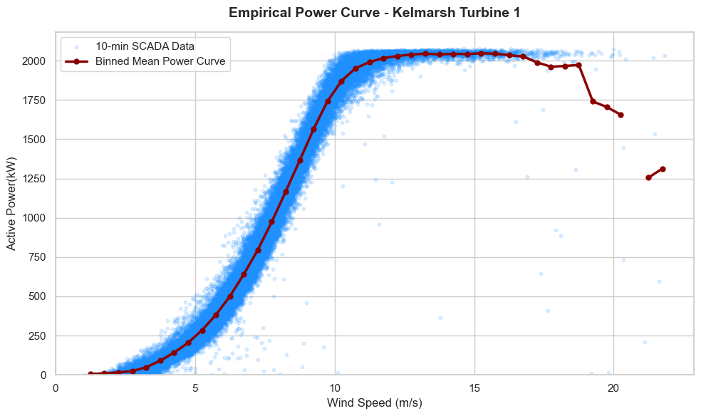
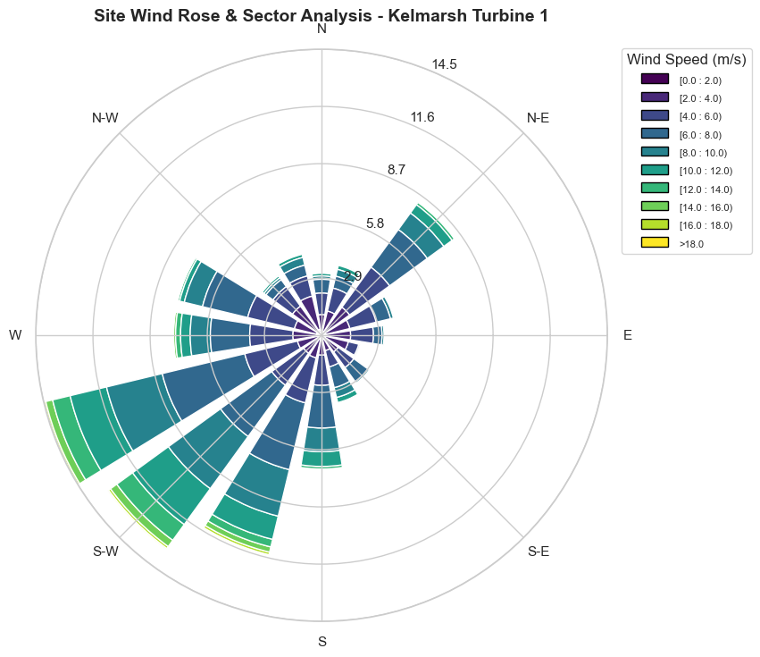

# Kelmarsh Scada Analysis
An end-to-end Python data analysis repository exploring SCADA telemetry from the Kelmarsh Wind Farm (6x Senvion MM92 turbines)

## 📌 Project Overview
This portfolio project demonstrates practical techniques in wind turbine performance monitoring, operational data cleaning, empirical power curve generation, and operational anomaly detection.

### Key Objectives:
* **Data Quality & Availability:** Preprocess, resample, and audit raw 10-minute SCADA logs.
* **Empirical Power Curve Analysis:** Isolate normal turbine operation from curtailment and downtime using filtering algorithms.
* **Environmental Assessment:** Map site wind resource distributions using wind roses and directional sector analysis.
* **Operational Anomalies:** Analyze SCADA telemetry during documented maintenance/fault events.

## 📊 Sample Visualizations
*(Include key high-resolution plots generated during your analysis)*

| Empirical Power Curve | Site Wind Rose |
| :---: | :---: |
|  |  |

## 🛠️ Tech Stack & Methods
* **Language:** Python 3.10+
* **Data Processing:** `pandas`, `numpy`
* **Visualization:** `matplotlib`, `seaborn`, `plotly`, `windrose`
* **Domain Tools:** OpenWindSCADA signal mapping concepts

## 🚀 Getting Started
*What is Power Curve?
