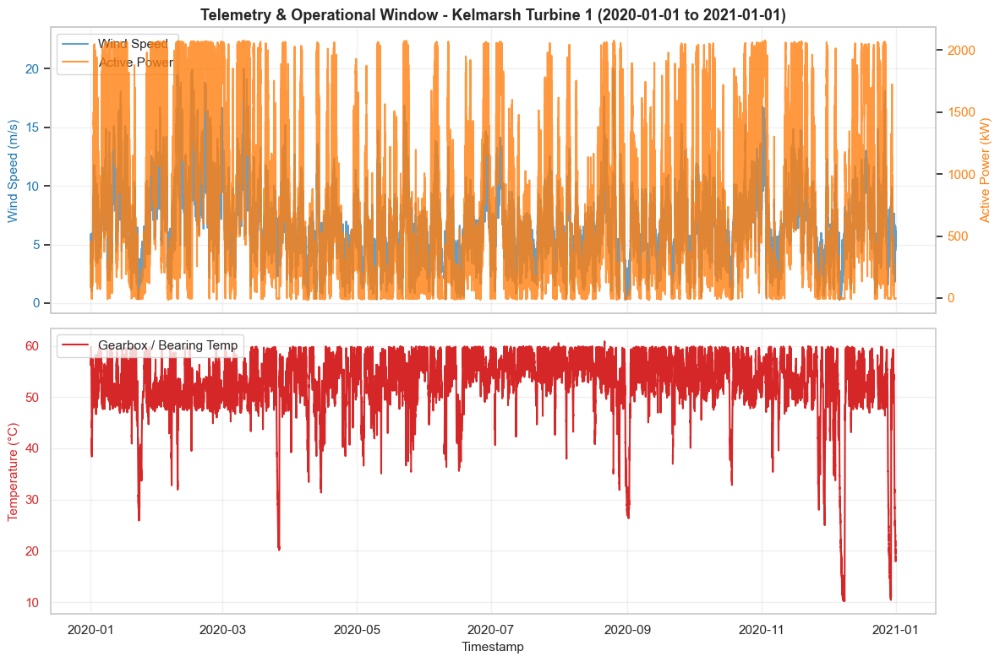

# Kelmarsh Scada Analysis
An end-to-end Python data analysis repository exploring SCADA telemetry from the Kelmarsh Wind Farm (6x Senvion MM92 turbines)

## 📌 Project Overview
This project demonstrates practical techniques in wind turbine performance monitoring, operational data cleaning, empirical power curve generation, and operational anomaly detection.

### Key Objectives:
* **Data Quality & Availability:** Preprocess, resample, and audit raw 10-minute SCADA logs.
* **Empirical Power Curve Analysis:** Isolate normal turbine operation from curtailment and downtime using filtering algorithms.
* **Environmental Assessment:** Map site wind resource distributions using wind roses and directional sector analysis.
* **Operational Anomalies:** Analyze SCADA telemetry during documented maintenance/fault events.

## 📊 Sample Visualizations
*(Include key high-resolution plots generated during your analysis)*

| Empirical Power Curve | Site Wind Rose | Anomaly Detection Time-series |
| :---: | :---: | :---: |
|  |  |  |

## 📜 Acknowledgments
* SCADA dataset provided open-access by Cubico Sustainable Investments. Source: https://zenodo.org/records/5841834#.YgpBQ_so-V7
* Workflows adapted from the open-source OpenWindSCADA project.

## 🚀 Getting Started
### 1. SCADA Dataset Cleaning
Real-world SCADA data is notoriously messy, filled with missing timestamps, and scattered. There is several data cleaning approaches:
* **Alignment & Missing Timestamps:** SCADA system log data is recorded every 10 minutes and often creates missing rows or irregular time intervals. We reindex to a continuous strict 10-minute frequency and explicitly identify missing timestamps.
* **Operational State Filtering:**  Remove data when the turbine is completely stopped or throttled. For example, because of maintenance (High Wind speed but active power = 0 kW) and Curtailment (High wind speed but artificially capped to 500 kW)
* **Sensor fault:**  If an anemometer detects wind direction for exactly the same decimal value for 20 consecutive records

For this project, we simplify by only excluding missing timestamps and Power = NaN from our calculation.
### 2. Power Curve
The relationship between wind speed and active power is a fundamental performance analysis of a wind turbine.

